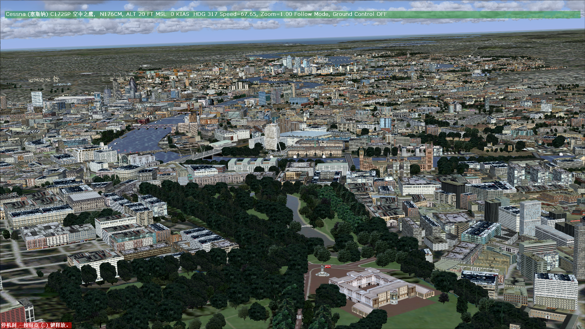
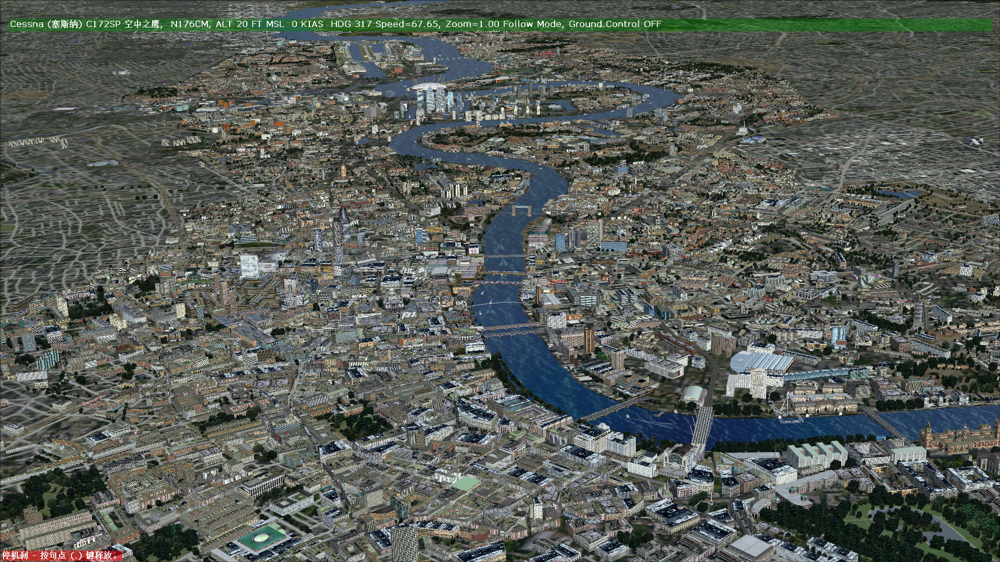
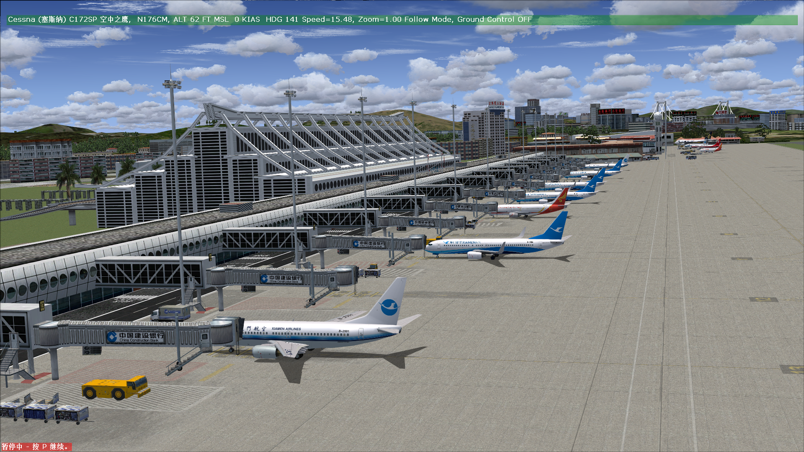
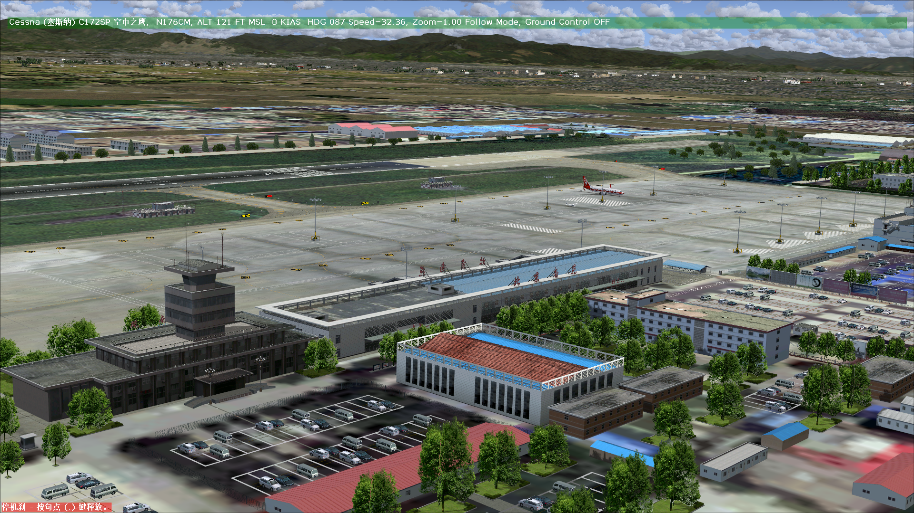

# Convert FSX Scenery To FS2004

Codex skill for converting Microsoft Flight Simulator X scenery packages into non-destructive Microsoft Flight Simulator 2004 scenery-library packages.

这是一个 Codex skill，用于将 Microsoft Flight Simulator X 地景包转换为 Microsoft Flight Simulator 2004 可用的独立地景库包，并尽量保留机场、建筑、地面贴图、地形和贴图效果。

## What This Skill Does

This skill guides Codex through a conservative FSX-to-FS2004 scenery conversion workflow:

- Recover airport XML with ADE, NewBglAnalyze, or BGLAnalyze, then compile with FS2004 BGLComp.
- Convert or rebuild object libraries, placement BGLs, ground polygons, and terrain-related outputs.
- Convert DDS textures to FS2004-compatible extended BMP formats with mipmaps.
- Diagnose common FS2004 conversion problems such as missing airports, buried or floating buildings, white textures, wrong texture orientation, transparent buildings, misplaced objects, short ground-texture draw distance, and default-airport overlap.
- Build output as a separate package with `scenery` and `texture` folders so original FSX files are not modified.
- Optionally remove or hollow out one airport from a package directory while preserving other airports in the same scenery cell.

## 功能简介

这个 skill 会引导 Codex 执行较稳妥的 FSX 到 FS2004 转换流程：

- 使用 ADE、NewBglAnalyze 或 BGLAnalyze 恢复机场 XML，并用 FS2004 版 BGLComp 编译。
- 转换或重建模型库、摆放记录、地面多边形和必要的地形输出。
- 将 DDS 贴图转换为 FS2004 支持的 extended BMP，并生成完整 mipmap。
- 主动处理常见问题：机场列表缺失、建筑埋地或悬空、白色贴图、贴图上下颠倒、透明度错误、建筑摆放角度错误、默认机场重叠、地面贴图显示距离过短等。
- 输出为独立 FS2004 地景包，包含 `scenery` 和 `texture` 文件夹，不修改 FSX 原包。
- 可选支持从某一目录中移除指定机场的全部本地内容，同时保留同一 BGL/cell 中的其他机场。

## Requirements

Prepare the relevant tools before asking Codex to run the conversion:

- FS2004 BGLComp SDK: `BGLComp.exe`, `bglcomp.xsd`
- FS2004 MakeMDL SDK: `MakeMDL.exe`
- FS2004 Terrain SDK: `ImageTool.exe`
- ADE 1.78 or compatible
- NewBglAnalyze or BGLAnalyze
- ModelConverterX
- SCASM
- Python with Pillow and pywinauto
- Optional: DXTBmp for manual texture inspection

Codex will ask for tool paths at the beginning of the workflow and will pause when a GUI tool needs manual confirmation.

## 所需工具

开始转换前，建议先准备以下工具：

- FS2004 版 BGLComp SDK：`BGLComp.exe`、`bglcomp.xsd`
- FS2004 MakeMDL SDK：`MakeMDL.exe`
- FS2004 Terrain SDK：`ImageTool.exe`
- ADE 1.78 或兼容版本
- NewBglAnalyze 或 BGLAnalyze
- ModelConverterX
- SCASM
- 安装 Pillow、pywinauto 的 Python 环境
- 可选：DXTBmp，用于人工检查贴图

Codex 会在流程开始时要求用户提供这些路径。遇到 ADE、MCX 等需要人工点击确认或保存的步骤时，Codex 会暂停并给出操作指引。

## Installation

Copy this skill folder into your Codex skills directory:

```text
C:\Users\<you>\.codex\skills\convert-fsx-scenery-to-fs2004
```

The folder should contain:

```text
SKILL.md
agents/
references/
scripts/
```

Restart or reload Codex if your environment does not discover new skills automatically.

## 安装方法

将本目录放入 Codex 的 skills 目录，例如：

```text
C:\Users\<你的用户名>\.codex\skills\convert-fsx-scenery-to-fs2004
```

目录中应包含：

```text
SKILL.md
agents/
references/
scripts/
```

如果 Codex 没有自动发现新 skill，请重启或刷新 Codex 环境。

## Example Prompts

English:

```text
Use convert-fsx-scenery-to-fs2004 to convert D:\Microsoft Flight Simulator X\Addon Scenery\Example Airport.
```

```text
Convert this FSX scenery into a separate FS2004 package. Do not modify the source files.
```

中文：

```text
使用 convert-fsx-scenery-to-fs2004，转换 D:\Microsoft Flight Simulator X\Addon Scenery\某机场。
```

```text
把这个 FSX 地景转换为 FS2004 格式，原文件不要动，输出一个可直接加入地景库的文件夹。
```

## Safety Principles

- The original FSX package must not be deleted, overwritten, or renamed.
- Conversion output should go into a separate directory.
- Unsupported content should be skipped and documented rather than forced into a broken FS2004 BGL.
- User-identified objects must be matched by parsed coordinates, placement GUIDs, and distance/bearing evidence, not by filename guesses.
- If a tool such as ADE or MCX requires manual action, Codex should provide clear instructions and wait for confirmation.

## 安全原则

- 不删除、不覆盖、不重命名 FSX 原始地景文件。
- 输出目录必须与源目录分开。
- 技术上难以可靠转换的内容应记录原因并跳过，不强行生成有问题的 FS2004 BGL。
- 用户指出某一建筑、跑道端、方位或物体时，必须结合坐标、GUID、距离和方位判断，不能只靠文件名猜测。
- ADE、MCX 等 GUI 工具需要人工操作时，应由 Codex 说明步骤并等待确认。

## Showcase / 效果展示








